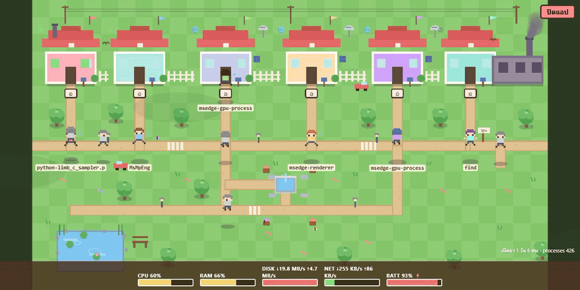

<div align="center">



# 🏙️ PC Town

**ดูการทำงานของคอมพิวเตอร์คุณ เป็นเมือง RPG น่ารักๆ**
*Watch your computer come alive as a tiny pixel-art RPG town*

เปิดเมื่อไหร่ก็เห็น — ปิดแท็บปุ๊บ หายเงียบจากเครื่องปั๊บ (ไม่รันคลั่งกิน RAM)
Runs only while you're looking. Closes itself ~5s after you leave.

</div>

---

## 🎮 It does what / มันทำอะไรได้

| In the town | On your machine |
|---|---|
|  ตัวละคร 6 ตัวเดิน/วิ่งตามถนน | 6 โปรเซสที่ใช้ CPU สูงสุด — ยิ่งกิน CPU ยิ่งวิ่งเร็ว, ว่างก็ยืนหลับ (zZz) |
| 🏠 บ้านแต่ละหลังหน้าตาไม่ซ้ำกัน | ประเภทแอป: 🌐 browser (มีจานดาวเทียม) · 🎵 media (ลำโพง+โน้ต) · 🎮 game (หลังคาจอย) · 🛠 dev (ปล่อง+ไฟเขียวกระพริบ) · 💬 chat (ซองจดหมาย) |
| 🪧 ป้ายใต้ตัวละคร | ชื่อจริง + **ชื่อหน้าต่างที่เปิดอยู่** เช่น `msedge·How to install a...` — แยกตัวที่ชื่อซ้ำได้ |
|  ควันจากปล่องโรงงาน | Disk read/writ activity |
| 🚶‍♀️ ผู้มาเยือนเดินข้ามเมือง | Network traffic |
| ☁️ เงาเมฆ/นก/ผีเสื้อ/หญ้าไหว | atmosphere 😄 (และ HUD ล่าง = CPU·RAM·DISK·NET·BATTERY จริง) |

**คลิกบ้านหรือตัวละคร** → เมนูเฉพาะตัว:

- 📊 กราฟแท่ง CPU 30 วินาทีล่าสุด
- 🪟 การ์ดเต็ม: ชื่อหน้าต่าง · role (เช่น renderer/gpu-process) · parent process · รันมานานเท่าไหร่ · คำสั่งเต็ม (cmdline)
- 📌 **Pin** ปักหมุดบ้านไว้แม้โปรเซสตกอันดับ · 👁 **Hide** ซ่อนบ้าน (เป็นบ้านมืด) · ☠ **Kill** ปิดแอปจริง (ต้องกดยืนยันสองครั้ง)

## 🚀 Quick start (Windows)

```powershell
# 1) ติดตั้ง dependency (ครั้งเดียว)
python -m pip install psutil

# 2) รันเลย — เปิด browser ให้เอง
pythonw pc_town.py
```

หรือสร้าง shortcut บน Desktop:

```powershell
$pyw = (Get-Command pythonw.exe).Source
$ws = New-Object -ComObject WScript.Shell
$lnk = $ws.CreateShortcut("$([Environment]::GetFolderPath('Desktop'))\PC Town.lnk")
$lnk.TargetPath = $pyw
$lnk.Arguments = '"D:\PC_Town\pc_town.py"'   # แก้ path ตามที่ clone ไว้
$lnk.IconLocation = 'D:\PC_Town\pc_town.ico,0'
$lnk.Save()
```

> 💡 ดับเบิลคลิกที่ไอคอนบ้านเพื่อเปิดเมือง — จบแล้วปิดแท็บ browser, ตัว server ปิดตัวเองภายใน 5 วินาที (heartbeat watchdog) ไม่มี process ค้าง

## 🧠 How it works

```
 pc_town.py (ไฟล์เดียวจบ)
 ├── Sampler thread ─ psutil อ่าน CPU/RAM/Disk/Net/Battery + top processes (1 Hz)
 │                    └ ชื่อหน้าต่างจาก Win32 (ctypes EnumWindows) — ไม่มี dependency เพิ่ม
 ├── ThreadingHTTPServer (127.0.0.1 เท่านั้น)
 │    GET  /            → หน้าเกม (HTML+Canvas ฝังในตัวไฟล์)
 │    GET  /api/status  → JSON snapshot
 │    GET  /api/ping    → heartbeat (ปิดแท็บ = server ตายเอง)
 │    POST /api/pin|hide|kill|shutdown
 └ single-instance lock (port 8766) — คลิกซ้ำไม่รันซ้อน

 ฝั่ง browser: Canvas ล้วน 60fps, ค่าจาก API (1 Hz) ผ่าน lerp → เดินเนียน, DPR-aware คมทุกจอสเกล
```

- **RAM/CPU ตอนปิดอยู่ = 0** — ไม่มี service, ไม่เข้า startup
- **Kill ปลอดภัยสองชั้น**: frontend ต้องกดยืนยันซ้ำ + backend ตรวจว่า pid ตรงกับ snapshot ล่าสุดจริงก่อน terminate
- **Localhost only** — ไม่มีข้อมูลออกจากเครื่องคุณ

## 🧪 Development

```bash
pip install pytest
python -m pytest tests -v      # unit + integration (ปิด app instance ก่อนรัน)
```

โครงสร้าง: โค้ดแอปทั้งหมดอยู่ใน `pc_town.py` (server + game) · `tests/` · specs/plans จริงใน `docs/superpowers/`

## 📸 Recording this GIF

The demo above is captured live (Chrome DevTools screencast → ffmpeg); to record your own see [`docs/readme/capture.js`](docs/readme/capture.js).

<div align="right">

Made with 🏠 and way too much pixel coffee on a Windows machine that just wanted to be a town.

</div>
